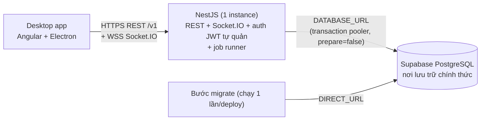
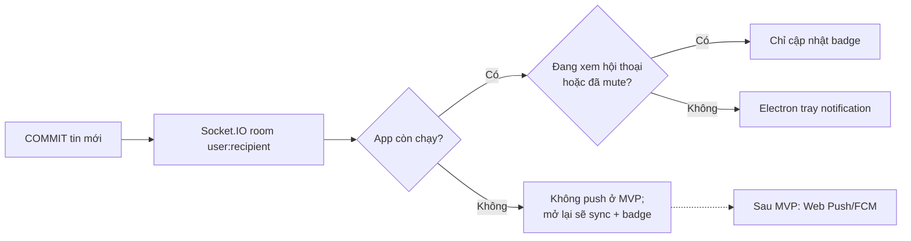
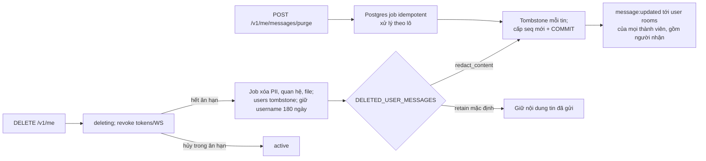

# Bước 2 — Kiến trúc (đã xác nhận, cập nhật)

## 2.1 Thành phần và triển khai

**Hướng chính thức (D15): Frontend → NestJS → Supabase PostgreSQL.** Socket.IO nằm trong NestJS.



| Có trong luồng chat | Không dùng ở giai đoạn đầu |
|---|---|
| NestJS: REST, Socket.IO (kết nối giữ trong bộ nhớ), JWT + refresh tự quản, job đọc từ bảng `jobs` | **Redis** — chỉ xét Redis adapter khi chạy nhiều instance |
| Supabase PostgreSQL — chỉ dùng như Postgres thuần | **Supabase Realtime** — Socket.IO đã phát tin, không chạy song song |
| | **Supabase Auth** — NestJS tự xác thực (D1) |

Local dev: `npm run dev` chạy API ở `http://localhost:3000`, cho phép CORS từ `http://localhost:4200`; đặt `DATABASE_URL` trong `be-chat-box/.env` để dùng PostgreSQL bền vững (ví dụ Supabase). Nếu thiếu, BE cảnh báo và dùng PostgreSQL nhúng tạm thời; dữ liệu bị xóa khi dừng. Các API Google OAuth, hồ sơ, tìm tài khoản/bạn bè, hội thoại và tin nhắn đã được triển khai; WebSocket và các luồng auth email/OTP/password chưa có.

Phụ trợ, nằm ngoài luồng chat chính: lưu file đính kèm (S3 API, ví dụ Supabase Storage), gửi mail OTP. Cả hai đều do NestJS điều khiển.

- **D10:** Một instance, nên Socket.IO rooms, presence/typing (`PresenceStore`) và rate limit (`RateLimitStore`) đều nằm trong bộ nhớ. Restart thì mất presence và bộ đếm tạm thời; client kết nối lại rồi sync theo seq. Thu hồi token kiểm `devices.revoked_at`/`users.status` trong Postgres trước mọi lần ghi và khi WS xác thực lại.
- **D13:** Một tiến trình NestJS làm cả REST, WS lẫn job (job bền trong bảng Postgres, `FOR UPDATE SKIP LOCKED`; không BullMQ — D14). Migration chạy **một lần** ở bước deploy riêng qua `DIRECT_URL`, không để app tự migrate khi khởi động. **Khi cần nhiều instance** (ngoài phạm vi hiện tại): thêm Redis adapter cho Socket.IO, chuyển hai store sang Redis, cân nhắc tách job ra tiến trình riêng.
- **D11:** Room Socket.IO `user:<userId>` và `device:<deviceId>`; fan-out 1-1 gửi cho hai user rooms. WS handshake kiểm JWT, trạng thái user/device. Hết hạn access token: server yêu cầu `auth:refresh`, cho thời gian ngắn rồi chủ động ngắt nếu không xác thực lại; client lấy access token mới qua REST và gửi lại. Logout từ xa/reset mật khẩu: ngắt socket ngay; kể cả bỏ lỡ sự kiện ngắt, server kiểm trạng thái device trước mọi write và ở lần re-auth. Khi có nhóm đông sau MVP, phát theo từng user room tốn O(thành viên); lúc đó cân nhắc room theo hội thoại và giới hạn kích thước nhóm.
- **D12:** Electron **main process** gọi presigned PUT/GET, stream file, báo tiến trình qua IPC; hủy bằng AbortController; tiếp tục sau mất mạng: multipart upload nếu storage hỗ trợ hoặc upload lại từ đầu với file nhỏ, giữ `uploadId`/trạng thái local. Mỗi phần có checksum, xác nhận qua HEAD/complete. **Bản web sau này sẽ cần CORS** trên bucket cho origin đã duyệt.
- Màn hình onboarding, giao diện thông báo và **trang tải app** phải nói rõ: **đóng hẳn app thì không nhận thông báo**; mở lại sẽ sync và hiện badge.

## 2.2 Đăng ký và đăng nhập

```mermaid
sequenceDiagram
  autonumber
  participant C as Desktop
  participant A as NestJS
  participant M as In-memory rate limits
  participant DB as Postgres
  participant J as DB jobs + mail worker
  C->>A: POST /v1/auth/register {username,email,password}
  A->>M: rate limit trước Argon2
  A->>A: semaphore Argon2; hết slot: 503 + Retry-After
  A->>DB: pending (+24h), identity, OTP HMAC; email active -> registrationId giả
  A->>J: enqueue OTP hoặc mail cảnh báo (theo trần)
  A-->>C: 202 {registrationId}
  C->>A: POST /v1/auth/register/verify {registrationId,code}
  A->>DB: consume OTP; active; tạo device + refresh + deviceToken
  A-->>C: access + refresh + deviceToken
  C->>C: main lưu refresh/deviceToken trong safeStorage
  C->>A: POST /v1/auth/login {identifier,password,deviceToken?}
  A->>M: rate limits IP/identifier; trusted device chỉ miễn khóa identifier
  A->>A: Argon2 thật/giả dưới semaphore
  alt sai hoặc không active
    A-->>C: 401 INVALID_CREDENTIALS
  else thiết bị mới và newDeviceOtp=true
    A->>J: enqueue OTP thiết bị
    A-->>C: challengeId
    C->>A: POST /v1/auth/login/otp {challengeId,code}
  end
  A->>DB: device limit; phát refresh family và deviceToken
  A-->>C: access + refresh + deviceToken
  C->>A: POST /v1/auth/refresh {refreshToken}
  A->>DB: atomic rotation; reuse => revoke family
  A-->>C: access + refresh mới hoặc 401
```

## 2.3 Gửi tin, fan-out và đồng bộ

```mermaid
sequenceDiagram
  autonumber
  participant C as Sender desktop
  participant A as NestJS WS
  participant DB as Postgres
  participant R as Recipient desktop
  C->>A: message:send {conversationId,clientMsgId,body,attachmentIds} (ack)
  A->>DB: BEGIN; khóa conversation + cặp friendship/block theo thứ tự cố định
  A->>DB: kiểm idempotency, quyền thành viên, bạn bè, không chặn
  alt clientMsgId đã tồn tại
    A-->>C: ack {messageId,seq cũ}
  else hợp lệ
    A->>DB: tăng last_seq; INSERT messages + change event; COMMIT
    A-->>C: ack {messageId,seq,serverTime}
    A-->>R: message:new (room user:recipient)
  end
  Note over C,R: Fan-out sau commit; thất lạc sự kiện được bù bằng sync
  R->>A: reconnect WS (để nhận sự kiện mới)
  R->>A: GET /v1/sync?cursor=...
  A->>DB: snapshot delta của user + last_seq từng conversation
  A-->>R: entities, tombstones, lastSeq, nextCursor
  loop hội thoại có lastSeq > localSeq
    R->>A: GET /v1/conversations/:id/changes?afterSeq=localSeq
    A-->>R: messages + edits/revokes/purge, nextSeq
  end
  R->>R: Dexie upsert theo event seq, bỏ trùng
```

- Seq theo hội thoại, cấp trong transaction sau khi kiểm trùng; rollback không tạo lỗ. **Bước 3** chốt cách không hụt seq với edit/purge và chính sách xóa sự kiện.
- Chặn/hủy bạn xảy ra đồng thời với gửi tin: transaction khóa hàng **theo thứ tự cố định** để không lọt tin sau chặn và tránh deadlock. Không tin thông tin quan hệ từ client.
- Sync cursor thực thể không dùng đồng hồ client; dùng change log theo offset server cho membership/friends/settings, riêng tin dùng seq. Không dựa vào `updated_at` đơn lẻ (có thể bỏ sót commit muộn).

## 2.4 Upload file

```mermaid
sequenceDiagram
  autonumber
  participant M as Electron main
  participant A as NestJS
  participant DB as Postgres
  participant S as S3-compatible storage
  M->>M: SHA-256, size, MIME candidate
  M->>A: POST /v1/attachments {sha256,size,mime,fileName}
  A->>DB: quota + dedup theo owner
  A-->>M: attachmentId + presigned PUT hoặc multipart uploadId
  M->>S: PUT/parts (progress, cancel, resume qua IPC)
  M->>A: POST /v1/attachments/:id/complete
  A->>S: HEAD/checksum; thiếu checksum -> worker tự băm
  A->>DB: status=verifying; enqueue verify job
  A-->>M: 202
  A->>S: worker kiểm magic bytes; reject/delete hoặc ready
  A-->>M: attachment:updated qua WS
  M->>A: GET /v1/attachments/:id/download
  A->>DB: owner hoặc thành viên hội thoại được phép đọc tin có file
  A-->>M: presigned GET TTL ngắn, Content-Disposition attachment
  M->>S: GET (có thể resume qua Range nếu storage hỗ trợ)
```

## 2.5 Thông báo



## 2.6 Purge và xóa tài khoản



⚖ **Chờ ý kiến pháp lý:** quyền xóa tin của người gửi có thể xung đột với bản chụp tin nhắn đã được báo cáo để xử lý vi phạm. MVP chưa có tính năng báo cáo; nếu có yêu cầu bảo toàn chứng cứ từ bên ngoài, cần chính sách lưu giữ tách biệt, kiểm soát truy cập và thời hạn rõ ràng trước khi bật purge trên dữ liệu đó.
