# Bước 3 — Cơ sở dữ liệu (đã xác nhận về thiết kế; kiểm chứng DB đang chờ)

> PostgreSQL thuần trên Supabase; UUID do app sinh (`crypto.randomUUID()`), thời gian do DB cấp; `BIGINT` seq trả qua API dạng **string** để không mất chính xác trong JavaScript. **DDL chuẩn nằm tại [`../db/schema.sql`](../db/schema.sql), role/grant/RLS tại [`../db/roles.sql`](../db/roles.sql).** Nơi chạy NestJS chưa chốt; dev dùng docker-compose. Không tạo bảng hay trường dành cho AI.

## 3.1 Quy tắc dữ liệu

- Hai tầng thứ tự: `conversation_changes.seq` tăng liên tục trong từng hội thoại (gửi, thu hồi, purge); `user_changes.seq` tăng liên tục **theo từng người dùng** (danh sách hội thoại, lời mời, quan hệ, settings, block, thiết bị). Không phân trang bằng `updated_at`: giao dịch commit trễ có thể bị bỏ qua.
- `messages.created_seq` là seq ban đầu, **không đổi** khi sửa/xóa; `conversation_changes` là nhật ký thay đổi có seq mới. `messages` giữ bản mới nhất. Tombstone **không xóa event** khi còn user cần đồng bộ. `client_msg_id` duy nhất **theo hội thoại**, dù người gửi khác; app dùng UUID v4.
- Khóa chính: UUID; `seq` BIGINT. Tất cả khóa ngoại về `users.id` không cascade xóa user đã xóa: giữ hàng tombstone.
- `group` chỉ là giá trị được DB chấp nhận để mở rộng schema; chỉ API `direct` được tạo. DDL **không tự chặn** người có quyền ghi DB chèn group, vì reserved value phải hợp lệ để nâng cấp sau.
- Các thay đổi tên hiển thị/avatar dùng optimistic `version`; khi xung đột trả 409 + bản hiện tại. Tin và quan hệ dùng transaction, không LWW.

## 3.2 ERD

```mermaid
erDiagram
  users ||--o{ identities : owns
  users ||--o{ devices : owns
  devices ||--o{ refresh_tokens : rotates
  users ||--o{ auth_challenges : requests
  users ||--o{ recovery_codes : has
  users ||--|| user_settings : configures
  users ||--o{ user_changes : syncs
  users ||--o{ user_blocks : blocks
  users ||--o{ friend_requests : sends
  users ||--o{ friendships : belongs
  users ||--o{ conversation_members : joins
  conversations ||--o{ conversation_members : has
  conversations ||--o{ messages : has
  conversations ||--o{ conversation_changes : ordered_events
  messages ||--o{ conversation_changes : changes
  messages ||--o{ message_attachments : includes
  attachments ||--o{ message_attachments : attached
  users ||--o{ attachments : uploads
  users ||--o{ export_requests : exports
  users ||--o{ audit_logs : audited
  users ||--o{ jobs : scheduled_for
  plans ||--o{ licenses : assigns
  users ||--|| licenses : subscribes
  billing_events }o--|| licenses : updates
```



`friendships` và `user_blocks` lưu cặp user theo hướng được mô tả bên dưới. `conversation_members` giữ hàng của người đã xóa để người còn lại đọc được lịch sử; guard từ chối user `deleted`.

## 3.3 DDL PostgreSQL (MVP)

```sql
-- App sinh UUID; schema không dùng extension riêng của nhà cung cấp.
-- Mọi truy cập của app dùng vai trò DB tối thiểu; migration dùng vai trò DDL riêng.
CREATE TABLE users (
  id uuid PRIMARY KEY,
  username varchar(30),
  display_name varchar(80),
  avatar_key text,
  password_hash text,
  pepper_version varchar(16),
  status varchar(12) NOT NULL DEFAULT 'pending'
    CHECK (status IN ('pending','active','deleting','deleted')),
  pending_expires_at timestamptz,
  deletion_due_at timestamptz,
  deleted_at timestamptz,
  profile_version integer NOT NULL DEFAULT 1 CHECK (profile_version > 0),
  change_seq bigint NOT NULL DEFAULT 0 CHECK (change_seq >= 0),
  created_at timestamptz NOT NULL DEFAULT now(),
  updated_at timestamptz NOT NULL DEFAULT now(),
  CONSTRAINT username_format CHECK (
    username IS NULL OR (username = lower(username) AND
    username ~ '^[a-z0-9_][a-z0-9_.]{1,28}[a-z0-9_]$' AND
    username !~ '\.\.')
  ),
  CONSTRAINT deleted_user_anonymous CHECK (
    status <> 'deleted' OR (username IS NULL AND display_name IS NULL AND
      avatar_key IS NULL AND password_hash IS NULL AND pepper_version IS NULL)
  ),
  CONSTRAINT pending_has_expiry CHECK (status <> 'pending' OR pending_expires_at IS NOT NULL)
);
CREATE UNIQUE INDEX users_username_unique ON users (username) WHERE username IS NOT NULL;
CREATE INDEX users_pending_expiry ON users (pending_expires_at) WHERE status = 'pending';
CREATE INDEX users_deletion_due ON users (deletion_due_at) WHERE status = 'deleting';

CREATE TABLE identities (
  id uuid PRIMARY KEY,
  user_id uuid NOT NULL REFERENCES users(id),
  type varchar(16) NOT NULL CHECK (type IN ('email','phone')),
  value text NOT NULL,
  verified_at timestamptz,
  created_at timestamptz NOT NULL DEFAULT now(),
  CONSTRAINT identity_canonical CHECK (value = lower(btrim(value)) AND length(value) BETWEEN 3 AND 320),
  UNIQUE (user_id, type, value)
);
-- Pending cùng email đăng ký đè, nên cũng không có 2 hàng pending cùng email.
-- Không có người dùng active khác chiếm email đó khi verify.
CREATE UNIQUE INDEX identities_type_value_unique ON identities (type, value);
CREATE INDEX identities_user_id_idx ON identities (user_id);

CREATE TABLE reserved_usernames (
  username varchar(30) PRIMARY KEY,
  reserved_until timestamptz NOT NULL,
  previous_user_id uuid NOT NULL REFERENCES users(id),
  created_at timestamptz NOT NULL DEFAULT now()
);
CREATE INDEX reserved_usernames_expiry ON reserved_usernames (reserved_until);

CREATE TABLE user_settings (
  user_id uuid PRIMARY KEY REFERENCES users(id),
  new_device_otp boolean NOT NULL DEFAULT true,
  locale varchar(8) NOT NULL DEFAULT 'vi',
  notifications_enabled boolean NOT NULL DEFAULT true,
  version integer NOT NULL DEFAULT 1 CHECK (version > 0),
  updated_at timestamptz NOT NULL DEFAULT now()
);

CREATE TABLE devices (
  id uuid PRIMARY KEY,
  user_id uuid NOT NULL REFERENCES users(id),
  name varchar(120) NOT NULL,
  token_hash bytea NOT NULL UNIQUE,
  token_pepper_version varchar(16) NOT NULL,
  last_seen_at timestamptz NOT NULL DEFAULT now(),
  created_at timestamptz NOT NULL DEFAULT now(),
  revoked_at timestamptz
);
CREATE INDEX devices_user_active ON devices (user_id) WHERE revoked_at IS NULL;

CREATE TABLE refresh_tokens (
  id uuid PRIMARY KEY,
  device_id uuid NOT NULL REFERENCES devices(id),
  family_id uuid NOT NULL,
  token_hash bytea NOT NULL UNIQUE,
  pepper_version varchar(16) NOT NULL,
  replaced_by uuid REFERENCES refresh_tokens(id),
  expires_at timestamptz NOT NULL,
  consumed_at timestamptz,
  revoked_at timestamptz,
  created_at timestamptz NOT NULL DEFAULT now()
);
CREATE UNIQUE INDEX refresh_family_live ON refresh_tokens (family_id)
  WHERE consumed_at IS NULL AND revoked_at IS NULL;
CREATE INDEX refresh_device_family ON refresh_tokens (device_id, family_id);
CREATE INDEX refresh_expiry ON refresh_tokens (expires_at);

CREATE TABLE auth_challenges (
  id uuid PRIMARY KEY,
  user_id uuid REFERENCES users(id),
  purpose varchar(16) NOT NULL CHECK (purpose IN ('register','device','reset','email_change')),
  target_email text NOT NULL,
  code_hash bytea NOT NULL,
  pepper_version varchar(16) NOT NULL,
  attempts smallint NOT NULL DEFAULT 0 CHECK (attempts BETWEEN 0 AND 5),
  pending_device_name varchar(120),
  expires_at timestamptz NOT NULL,
  consumed_at timestamptz,
  created_at timestamptz NOT NULL DEFAULT now()
);
CREATE INDEX auth_challenges_user_open ON auth_challenges (user_id, purpose, expires_at)
  WHERE consumed_at IS NULL;
CREATE INDEX auth_challenges_expiry ON auth_challenges (expires_at);

CREATE TABLE recovery_codes (
  id uuid PRIMARY KEY,
  user_id uuid NOT NULL REFERENCES users(id),
  code_hash bytea NOT NULL UNIQUE,
  pepper_version varchar(16) NOT NULL,
  used_at timestamptz,
  created_at timestamptz NOT NULL DEFAULT now()
);
CREATE INDEX recovery_codes_user ON recovery_codes (user_id);

CREATE TABLE friend_requests (
  id uuid PRIMARY KEY,
  sender_id uuid NOT NULL REFERENCES users(id),
  recipient_id uuid NOT NULL REFERENCES users(id),
  status varchar(10) NOT NULL DEFAULT 'pending'
    CHECK (status IN ('pending','accepted','declined','cancelled')),
  created_at timestamptz NOT NULL DEFAULT now(),
  updated_at timestamptz NOT NULL DEFAULT now(),
  CHECK (sender_id <> recipient_id)
);
CREATE UNIQUE INDEX friend_requests_one_pending ON friend_requests (sender_id, recipient_id)
  WHERE status = 'pending';
CREATE INDEX friend_requests_inbox ON friend_requests (recipient_id, created_at DESC)
  WHERE status = 'pending';

CREATE TABLE friendships (
  user_low uuid NOT NULL REFERENCES users(id),
  user_high uuid NOT NULL REFERENCES users(id),
  created_at timestamptz NOT NULL DEFAULT now(),
  PRIMARY KEY (user_low, user_high),
  CHECK (user_low < user_high)
);
CREATE INDEX friendships_high ON friendships (user_high, user_low);

CREATE TABLE user_blocks (
  blocker_id uuid NOT NULL REFERENCES users(id),
  blocked_id uuid NOT NULL REFERENCES users(id),
  created_at timestamptz NOT NULL DEFAULT now(),
  PRIMARY KEY (blocker_id, blocked_id),
  CHECK (blocker_id <> blocked_id)
);
CREATE INDEX user_blocks_blocked ON user_blocks (blocked_id, blocker_id);

CREATE TABLE conversations (
  id uuid PRIMARY KEY,
  type varchar(8) NOT NULL CHECK (type IN ('direct','group')),
  direct_user_low uuid REFERENCES users(id),
  direct_user_high uuid REFERENCES users(id),
  last_seq bigint NOT NULL DEFAULT 0 CHECK (last_seq >= 0),
  created_at timestamptz NOT NULL DEFAULT now(),
  updated_at timestamptz NOT NULL DEFAULT now(),
  CHECK ((type = 'direct' AND direct_user_low IS NOT NULL AND
          direct_user_high IS NOT NULL AND direct_user_low < direct_user_high)
      OR (type = 'group' AND direct_user_low IS NULL AND direct_user_high IS NULL))
);
CREATE UNIQUE INDEX conversations_one_direct ON conversations (direct_user_low, direct_user_high)
  WHERE type = 'direct';

CREATE TABLE conversation_members (
  conversation_id uuid NOT NULL REFERENCES conversations(id),
  user_id uuid NOT NULL REFERENCES users(id),
  joined_at timestamptz NOT NULL DEFAULT now(),
  muted boolean NOT NULL DEFAULT false,
  hidden_at timestamptz,
  last_read_seq bigint NOT NULL DEFAULT 0 CHECK (last_read_seq >= 0),
  PRIMARY KEY (conversation_id, user_id)
);
CREATE INDEX conversation_members_user ON conversation_members (user_id, conversation_id);
-- Direct: API tạo 2 member trong cùng transaction; truy vấn quyền còn phải
-- so user_id với direct_user_low/high. Không suy ra quyền chỉ từ membership.

CREATE TABLE messages (
  id uuid PRIMARY KEY,
  conversation_id uuid NOT NULL REFERENCES conversations(id),
  sender_id uuid NOT NULL REFERENCES users(id),
  client_msg_id uuid NOT NULL,
  -- SHA-256 của payload canonical (body + attachment IDs); retry khác payload -> 409.
  request_hash bytea NOT NULL CHECK (octet_length(request_hash) = 32),
  created_seq bigint NOT NULL CHECK (created_seq > 0),
  body text,
  body_deleted_at timestamptz,
  created_at timestamptz NOT NULL DEFAULT now(),
  updated_at timestamptz NOT NULL DEFAULT now(),
  CONSTRAINT messages_conversation_seq_unique UNIQUE (conversation_id, created_seq),
  CONSTRAINT messages_conversation_client_id_unique UNIQUE (conversation_id, client_msg_id),
  CONSTRAINT messages_conversation_id_unique UNIQUE (conversation_id, id),
  CHECK ((body_deleted_at IS NULL) OR (body IS NULL))
);
CREATE INDEX messages_conversation_latest ON messages (conversation_id, created_seq DESC);
CREATE INDEX messages_sender ON messages (sender_id, id);

CREATE TABLE conversation_changes (
  conversation_id uuid NOT NULL REFERENCES conversations(id),
  seq bigint NOT NULL CHECK (seq > 0),
  message_id uuid NOT NULL,
  kind varchar(12) NOT NULL CHECK (kind IN ('created','recalled','purged','redacted')),
  -- Không lưu body: sync đọc trạng thái hiện tại từ messages, nên dữ liệu đã xóa không còn bản sao.
  changed_at timestamptz NOT NULL DEFAULT now(),
  PRIMARY KEY (conversation_id, seq),
  FOREIGN KEY (conversation_id, message_id) REFERENCES messages (conversation_id, id)
);
CREATE INDEX conversation_changes_message ON conversation_changes (message_id, seq);

CREATE TABLE message_hidden_for (
  message_id uuid NOT NULL REFERENCES messages(id),
  user_id uuid NOT NULL REFERENCES users(id),
  hidden_at timestamptz NOT NULL DEFAULT now(),
  PRIMARY KEY (message_id, user_id)
);
CREATE INDEX message_hidden_for_user ON message_hidden_for (user_id, message_id);

CREATE TABLE attachments (
  id uuid PRIMARY KEY,
  owner_id uuid NOT NULL REFERENCES users(id),
  sha256 bytea NOT NULL CHECK (octet_length(sha256) = 32),
  object_key text NOT NULL UNIQUE,
  file_name varchar(255) NOT NULL,
  mime_type varchar(100) NOT NULL,
  byte_size bigint NOT NULL CHECK (byte_size BETWEEN 1 AND 104857600),
  status varchar(10) NOT NULL DEFAULT 'pending'
    CHECK (status IN ('pending','verifying','ready','rejected')),
  created_at timestamptz NOT NULL DEFAULT now(),
  updated_at timestamptz NOT NULL DEFAULT now(),
  UNIQUE (owner_id, sha256)
);
CREATE INDEX attachments_pending ON attachments (created_at)
  WHERE status IN ('pending','verifying');

CREATE TABLE message_attachments (
  message_id uuid NOT NULL REFERENCES messages(id),
  attachment_id uuid NOT NULL REFERENCES attachments(id),
  position smallint NOT NULL CHECK (position BETWEEN 0 AND 19),
  PRIMARY KEY (message_id, attachment_id),
  UNIQUE (message_id, position)
);
CREATE INDEX message_attachments_attachment ON message_attachments (attachment_id);

CREATE TABLE user_changes (
  user_id uuid NOT NULL REFERENCES users(id),
  seq bigint NOT NULL CHECK (seq > 0),
  entity_type varchar(24) NOT NULL CHECK (entity_type IN
    ('profile','settings','device','friend_request','friendship','block','conversation',
     'message_visibility','export')),
  entity_id uuid NOT NULL,
  kind varchar(8) NOT NULL CHECK (kind IN ('upsert','delete')),
  changed_at timestamptz NOT NULL DEFAULT now(),
  PRIMARY KEY (user_id, seq)
);

CREATE TABLE plans (
  id varchar(32) PRIMARY KEY,
  max_devices smallint NOT NULL CHECK (max_devices > 0),
  storage_bytes bigint NOT NULL CHECK (storage_bytes >= 0),
  enabled boolean NOT NULL DEFAULT true
);
CREATE TABLE licenses (
  user_id uuid PRIMARY KEY REFERENCES users(id),
  plan_id varchar(32) NOT NULL REFERENCES plans(id),
  status varchar(12) NOT NULL CHECK (status IN ('active','expired','suspended')),
  expires_at timestamptz,
  updated_at timestamptz NOT NULL DEFAULT now()
);
CREATE TABLE billing_events (
  provider varchar(64) NOT NULL,
  event_id varchar(255) NOT NULL,
  user_id uuid NOT NULL REFERENCES licenses(user_id),
  received_at timestamptz NOT NULL DEFAULT now(),
  processed_at timestamptz,
  PRIMARY KEY (provider, event_id)
);

CREATE TABLE export_requests (
  id uuid PRIMARY KEY,
  user_id uuid NOT NULL REFERENCES users(id),
  status varchar(12) NOT NULL CHECK (status IN ('queued','running','ready','failed','expired')),
  object_key text UNIQUE,
  expires_at timestamptz,
  created_at timestamptz NOT NULL DEFAULT now()
);
CREATE INDEX export_requests_user ON export_requests (user_id, created_at DESC);

CREATE TABLE feature_flags (
  name varchar(80) PRIMARY KEY,
  enabled boolean NOT NULL DEFAULT false,
  updated_at timestamptz NOT NULL DEFAULT now()
);
CREATE TABLE audit_logs (
  id uuid PRIMARY KEY,
  actor_id uuid REFERENCES users(id),
  subject_id uuid REFERENCES users(id),
  action varchar(80) NOT NULL,
  metadata jsonb NOT NULL DEFAULT '{}'::jsonb,
  created_at timestamptz NOT NULL DEFAULT now()
);
CREATE INDEX audit_logs_subject ON audit_logs (subject_id, created_at DESC);
CREATE INDEX audit_logs_actor ON audit_logs (actor_id, created_at DESC);
-- metadata allowlist: không chứa body, password, OTP, token, email hay tên file.

CREATE TABLE jobs (
  id uuid PRIMARY KEY,
  kind varchar(32) NOT NULL CHECK (kind IN
    ('send_mail','verify_attachment','export_data','purge_messages',
     'delete_account','cleanup_pending','cleanup_uploads','release_username')),
  user_id uuid REFERENCES users(id),
  idempotency_key varchar(200) NOT NULL UNIQUE,
  payload jsonb NOT NULL DEFAULT '{}'::jsonb,
  status varchar(10) NOT NULL DEFAULT 'queued'
    CHECK (status IN ('queued','running','done','failed')),
  attempts smallint NOT NULL DEFAULT 0 CHECK (attempts >= 0),
  run_at timestamptz NOT NULL DEFAULT now(),
  locked_until timestamptz,
  created_at timestamptz NOT NULL DEFAULT now(),
  updated_at timestamptz NOT NULL DEFAULT now()
);
CREATE INDEX jobs_next ON jobs (run_at, id)
  WHERE status IN ('queued','running');
-- Worker chọn job chạy được: status=queued AND run_at<=now() OR
-- status=running AND locked_until<now(), FOR UPDATE SKIP LOCKED LIMIT n.
-- Lease có thời hạn; hoàn tất job và cập nhật trạng thái idempotent.
```

**Giới hạn DDL cần xử lý ở tầng transaction:** đúng 2 member cho `direct`, quan hệ bạn bè và block trong lúc gửi tin, attachment phải `ready` và do người gửi sở hữu, password_hash/identity nhất quán khi `active`, tối đa quota và giữ chỗ username. DDL không thể biểu diễn các điều kiện phụ thuộc nhiều bảng mà không dùng trigger; ưu tiên transaction + test e2e, không thêm trigger ở MVP.

**Attachment sau purge:** `conversation_changes` không giữ body hay file. Bảng `message_attachments` bị xóa liên kết khi purge; client nhận tombstone seq mới rồi xóa bản cache. File gốc chỉ xóa nếu không còn tin khác trỏ tới. Dữ liệu cũ đã tải offline không thể thu hồi khỏi thiết bị người nhận.

## 3.4 Cấp seq không trùng, không hụt

```sql
-- message:send (minh họa; cùng transaction, sau khi đã khóa cặp user
-- theo thứ tự cố định bằng pg_advisory_xact_lock hoặc khóa rows users)
BEGIN;
SELECT last_seq FROM conversations WHERE id = $conversation_id FOR UPDATE;
SELECT id, created_seq FROM messages
 WHERE conversation_id = $conversation_id AND client_msg_id = $client_msg_id;
-- Nếu đã có: COMMIT, trả id+seq cũ; không cấp seq mới.
-- Nếu chưa có: kiểm caller thuộc cặp direct_user_low/high,
-- còn friendship và không có block cả hai hướng, attachment ready/owner.
UPDATE conversations SET last_seq = last_seq + 1, updated_at = now()
 WHERE id = $conversation_id RETURNING last_seq;
INSERT INTO messages (id, conversation_id, sender_id, client_msg_id, request_hash, created_seq, body)
 VALUES ($id, $conversation_id, $sender_id, $client_msg_id, $request_hash, $seq, $body);
INSERT INTO conversation_changes (conversation_id, seq, message_id, kind)
 VALUES ($conversation_id, $seq, $id, 'created');
COMMIT;
```

- Row lock trên `conversations` giữ tới commit, nên mọi writer của cùng conversation được xếp hàng. Nếu transaction lỗi/rollback thì counter cũng rollback; **không hụt seq do cấp phát**. Nếu app retry với cùng `clientMsgId`, trả kết quả cũ. Nếu cùng id nhưng `request_hash` khác, trả `409 IDEMPOTENCY_CONFLICT`.
- Chặn/hủy bạn và gửi tin cùng cặp user phải dùng **cùng một transaction-level advisory lock**, key băm từ cặp UUID đã chuẩn hóa. Lock này không phụ thuộc session, tương thích transaction pooler. Phải lấy lock cặp **trước** lock conversation ở mọi nơi để tránh deadlock. Hash collision của advisory key chỉ làm chậm cặp không liên quan, không ảnh hưởng tính đúng.
- Thu hồi/purge/sửa tin: khóa cặp (nếu cần) → khóa conversation → tăng seq → cập nhật `messages` → thêm `conversation_changes`. Purge nhiều tin dùng lô nhỏ, mỗi tin 1 seq; ghi event tombstone cho cả bên nhận. Không xóa vật lý `messages`/`conversation_changes` khi còn thành viên cần sync.
- `user_changes`: `UPDATE users SET change_seq=change_seq+1 ... RETURNING change_seq` trong cùng transaction với thay đổi entity, cho **mỗi user bị ảnh hưởng**; khóa các hàng user theo UUID tăng dần để tránh deadlock. Cursor `(user_id, seq)` không bỏ sót commit chậm. `GET /sync` đọc snapshot với high-water mark `users.change_seq` và trả các event `seq <= mark`; event cũ chỉ dọn sau khi đạt retention/snapshot rule.

## 3.5 Đồng bộ và xung đột

- `conversation_changes` trả event theo `(conversation_id, seq)`, join `messages` để lấy **trạng thái hiện tại** (body hoặc tombstone). Nhiều event cùng tin trong một trang được gộp thành trạng thái cuối. Cursor mỗi hội thoại là **seq event**, không phải `messages.created_seq`. `user_changes` trả entity changes theo `user_id + seq`.
- Client ghi Dexie transaction: áp events theo thứ tự, đặt cursor sau cùng. Nếu trang tin đến muộn/out-of-order thì đợi hoặc kéo lại từ `lastSeq`. Event trùng thì bỏ qua.
- `message_hidden_for` chỉ ảnh hưởng user đặt ẩn: ghi `user_changes` entity_type `message_visibility`; **không** xóa tin cho người còn lại.
- Với `user_settings`/`users` profile: `UPDATE ... WHERE version=$expected RETURNING ...`. 0 rows → 409 kèm bản hiện tại. Nếu cần LWW, client chủ động ghi lại với version mới, không để DB dựa vào giờ client.
- Khi một user đã xóa: `users` còn tombstone, `username`/PII bị xóa; thành viên còn lại vẫn đọc hội thoại, tác giả hiển thị "Người dùng đã xóa".

## 3.6 Xóa mềm, lưu giữ, partition

| Loại | Giữ bao lâu (đề xuất, cấu hình) | Xóa |
|---|---|---|
| `pending` | 24h | Xóa cứng user + identity + challenges; chưa có quyền/tin |
| Tài khoản `deleting` | Ân hạn **30 ngày** | Sau đó xóa PII, giữ users tombstone; `retain` nội dung tin (⚖ chờ pháp lý) |
| Username sau khi xóa | **180 ngày** | Job giải phóng `reserved_usernames` |
| OTP | 10 phút sử dụng; xóa hàng sau **24h** | Job dọn định kỳ |
| Refresh token đã dùng/thu hồi | **30 ngày** sau hết hạn để phát hiện reuse | Xóa qua job; token đang sống lưu tới expiry |
| Export archive | Link ký ngắn; file **7 ngày** | Lifecycle bucket + job |
| File upload bỏ dở | **24h** | Xóa object + metadata |
| Audit log | **180 ngày**, không có PII/body | Xóa theo lịch; thời hạn chính xác chờ pháp lý |
| Tin và change log | Khi tài khoản còn hoạt động; sau xóa theo policy/đồng bộ của người còn lại | Purge tạo tombstone; retention event cần snapshot trước khi xóa |

**Partition:** MVP không partition `messages` hay `conversation_changes`. Khi lớn: hash partition theo `conversation_id` (vd. 16 partition): hai unique `(conversation_id, created_seq)` và `(conversation_id, client_msg_id)` vẫn hợp lệ vì chứa partition key. Nếu buộc partition theo thời gian, cần bảng idempotency riêng không partition theo thời gian và bảng định tuyến conversation→partition; không âm thầm thay unique bằng `(conversation_id, client_msg_id, created_at)` (nó **không** đảm bảo idempotent). Chỉ cân nhắc khi benchmark/index/WAL chứng minh cần, không dựa trên số lượng user giả định.

**Quyền riêng tư và backup:** mã hóa volume và backup; backup bất biến có thể còn dữ liệu đã xóa cho tới hết vòng đời backup (đề xuất ≤30 ngày), phải công bố. ⚖ Cần tư vấn pháp lý về retention tin đã gửi, bản chụp tin bị báo cáo, thời hạn audit/backup và nơi host. Phải tính cả object storage và cache client trong chính sách xuất/xóa.

## 3.7 Kết nối NestJS → Supabase PostgreSQL

| Biến | Dùng cho | Chế độ Supabase | Cấu hình driver |
|---|---|---|---|
| `DATABASE_URL` | App runtime (Drizzle + `postgres` driver) | Transaction pooler, cổng `6543` | `postgres(url, { prepare: false })` — **bắt buộc**, transaction pooler không giữ prepared statement giữa các transaction. Tham số `?pgbouncer=true` là quy ước của Prisma, driver `postgres` bỏ qua nó |
| `DIRECT_URL` | Migration (`drizzle-kit migrate`), chạy 1 lần/deploy | Session pooler cổng `5432` (IPv4), hoặc direct connection nếu hạ tầng có IPv6 | Mặc định |

- Vì runtime đi qua transaction pooler: chỉ dùng **advisory lock theo transaction** (`pg_advisory_xact_lock`), không `LISTEN/NOTIFY`, không session lock, không temp table. Thiết kế seq ở §3.4 đã tuân theo.
- Kích thước pool phía app nhỏ (ví dụ 10) vì pooler Supabase đã gộp kết nối; giới hạn kết nối theo gói Supabase — kiểm tra tài liệu hiện hành.
- Env được validate lúc khởi động (zod): thiếu `DATABASE_URL` thì app không chạy; `DIRECT_URL` chỉ bắt buộc ở bước migrate.
- **Không** đưa password mẫu vào tài liệu, commit hay log. Chỉ cấu hình biến môi trường/secret store. Chuỗi `YOUR-PASSWORD` là placeholder, không phải thông tin xác thực.

## 3.8 Cần xác nhận trước Bước 4

1. `conversation_changes` **không lưu body** (đã áp dụng trong DDL). Lý do: lưu body trong change log tạo bản sao nội dung còn sót sau purge, mâu thuẫn quyền xóa. Đánh đổi: client không thấy trạng thái trung gian (tin tạo rồi bị thu hồi giữa hai lần sync chỉ hiện tombstone) — chấp nhận được.
2. `jobs` trong Postgres (không BullMQ), khớp hướng "không Redis giai đoạn đầu" (D15).
3. Thời gian ân hạn xóa tài khoản 30 ngày; giữ username 180 ngày; audit 180 ngày; backup ≤30 ngày — **tất cả là giá trị đề xuất**, cần tư vấn pháp lý.
